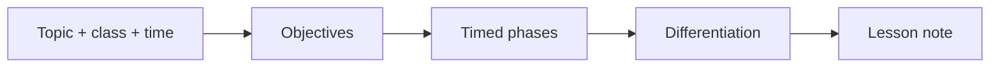

# Lesson Plan Generator

> Topic, class and duration in; a timed, structured lesson plan with objectives, activities and assessment out.

     

**Sector:** Education  ·  **Project 27 of 50** in my [AI Automation Projects series](https://github.com/Princewill106/Princewill106)

## The problem

Teachers are required to submit lesson notes every week, and writing them takes hours that should go into teaching. Plans written in a rush skip objectives and assessment, which is what makes a lesson work.

## How it works



1. **Input** — List lessons in `sample_scheme.json`: subject, class, topic, subtopics, minutes.
2. **Objectives** — Three objectives are generated at rising Bloom's levels (remember → apply → evaluate).
3. **Timing** — Phase lengths are allocated as proportions of the lesson so 40 and 80 minute lessons both add up.
4. **Differentiate** — Support and stretch tasks are added for each lesson.
5. **Export** — Each plan is saved to `output/` as Markdown, plus a weekly scheme of work.

## Features

- Bloom's-aligned objectives
- Phase timings that always add up
- Support and stretch tasks
- Exit-ticket questions
- Weekly scheme of work

## Quick start

```bash
git clone https://github.com/Princewill106/lesson-plan-generator.git
cd lesson-plan-generator
python main.py --demo
```

No installs needed: it uses only the Python standard library. The demo runs fully offline using the sample data in this repo.

**Optional: plug in an LLM.** Copy `.env.example` to `.env` and add an Anthropic or OpenAI key. The project will then use the model for the language-heavy steps and fall back to its rule-based logic if a call fails.

Run the tests:

```bash
python -m unittest -v
```

## Sample output

```text
# Computer Studies: Introduction to Automation

**Class:** JSS2  ·  **Duration:** 40 minutes  ·  **Week 1**

## Objectives

By the end of the lesson, learners will be able to:

1. Identify the key terms in introduction to automation
2. Explain how triggers works using an example
3. Design a simple workflows for a real problem

## Lesson sequence

| Phase | Minutes | Activity |
|---|---:|---|
| Starter | 4 | Quick question on the board: 'Where have you seen introduction to automation in daily life?' Pairs share. |
| Teach | 10 | Explain Triggers, Actions, Workflows with a worked example and a diagram. |
| Guided practice | 10 | Class works through an example of triggers together; teacher checks with mini whiteboards. |
| Independent task | 10 | Learners complete a short task applying workflows. |
| Plenary & exit ticket | 6 | Learners answer the exit-ticket questions; teacher collects them to plan the next lesson. |

## Differentiation

- Support: Provide a worked example and sentence starters for triggers.
- Stretch: Ask learners to compare two approaches to workflows and justify which is better.

## Resources

- projector, laptops, sample n8n workflow

## Exit ticket

- What is triggers?
- Give one real example of introduction to automation.
- What is one thing you are still unsure about?

Generated 3 lesson plans and output/scheme_of_work.md
```

## Use it in n8n (no code needed)

[`n8n-workflow.json`](n8n-workflow.json) is a ready-to-import n8n version of this project, built for n8n 1.x.

1. In n8n, open **Workflows → Import from File** and choose `n8n-workflow.json`.
2. Click **Test workflow**. It runs the full logic on the sample data built into the *Sample data* node, so you can see the results before connecting anything.
3. Open each output node and connect your accounts. For Google Sheets, pick your spreadsheet and sheet.
4. Adjust the settings at the top of the **Logic** node (thresholds, templates, contacts), then **Activate**.

**Flow:** **Webhook** (`POST /webhook/lesson-plan`) → **Logic** (Code node)

**Outputs:**


The Logic node is a JavaScript port of the rules in `main.py`, so you can run the project in n8n without Python.

## Use it on your own data

Fill `sample_scheme.json` with your week's lessons and run `python main.py`. Set an LLM key to get subject-specific activities and examples written for you.

## Project structure

```text
n8n-workflow.json            Importable n8n workflow
.env.example                 Optional API key settings
.gitignore                   Git ignore rules
LICENSE                      MIT license
README.md                    This file
llm.py                       Optional LLM helper (offline fallback)
main.py                      Entry point and core logic
requirements.txt             Dependencies (stdlib only)
sample_scheme.json           Sample input data for the demo
test_main.py                 Unit tests
```

## Who this is for

- Primary and secondary teachers
- Coding and robotics instructors
- Teacher trainers and school leaders reviewing plans

## Ideas to extend it

- [ ] Nigerian curriculum (NERDC) topic library
- [ ] Export to Word/PDF
- [ ] Slides outline per lesson
- [ ] Collect student reflections from exit tickets

## About

Built by **Ogbu Ugochukwu Princewill**, AI Automation Lead and robotics engineer. I teach people and businesses to build with AI, not just talk about it. [LinkedIn](https://www.linkedin.com/in/ugochukwu-ogbu-653a0816a)

If this helped you, give it a ⭐ and share what you built with it.

## License

MIT — see [LICENSE](LICENSE).
